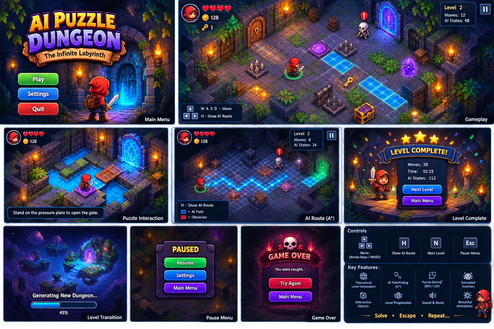

# AI Puzzle Dungeon — Enhanced Edition

An animated top-down 2D puzzle adventure dungeon game featuring intelligent AI enemies, multi-layered puzzle mechanics, fluid animations, synthesized retro sound effects, and procedural labyrinth generation.



## 🎮 How to Run

1. Open PowerShell or a command terminal in this directory (`d:\AI_Puzzle_Dungeon_Enhanced`).
2. Run with Python:
   ```powershell
   py main.py
   ```
   *(or `python main.py`)*

---

## 🕹️ Controls

| Key | Action |
| --- | --- |
| **WASD** / **Arrow Keys** | Move Adventurer (Smooth interpolation) |
| **SPACE** | Attack / Slash sword with visual glint |
| **A** / **TAB** | Toggle **Auto AI Assist** (Autonomous path navigation & auto-attack) |
| **H** | Toggle **AI Puzzle Path Route** (Pulsing neon energy beam) |
| **R** | Retry / Regenerate current dungeon (Preserves same level layout) |
| **N** | Advance to Next Level (when exit portal reached) |
| **ESC** | Return to Main Menu / Exit |
| **ENTER** / **Click** | Start Game from Menu |

---

## ✨ Features & Puzzles

### 🧩 Puzzle Mechanics
1. **Gold Keys & Locked Reinforced Doors**: Collect keys to unlock doors blocking critical corridors.
2. **Levers & Magic Energy Gates**: Pulling wall levers permanently switches magical barriers on/off.
3. **Sokoban Pushable Wooden Crates**: Push heavy crates to unblock routes or bypass hazardous spike lines.
4. **Slippery Ice Surfaces**: Frictionless ice blocks propel the player forward across gaps.
5. **Teleportation Portals**: Step into mystical violet rifts to instantly warp across the labyrinth.
6. **Retractable Floor Spikes**: Floor hazards that damage careless wanderers.
7. **Collectible Emerald Gems**: High-value bonus gems scattered in secret chambers.

### 👾 4 AI Enemy Archetypes
1. **Slime**: Bouncy, gelatinous patrol enemies that wander halls and turn on walls.
2. **Bat**: Quick, erratic predators that flutter fast and home in on the player.
3. **Skeleton**: Smart chasers that calculate **A\* pathfinding** toward the player when within vision radius.
4. **Ghost**: Spectral pursuers that phase across hazards and track the player smoothly.

### 👹 Level 6 Boss Battle: The Chaos Guardian
* **Appearance & Colossus Size**: A massive 2x2 stone & purple crystal behemoth with orbiting runic energy rings and crystalline claws.
* **3-Phase Adaptive AI Fight**:
  1. **Phase 1 (The Awakening)**: Pursues the player via A\* pathfinding while you work to complete the 4-quadrant Elemental Altar sequence.
  2. **Phase 2 (The Rage)**: Speeds up, roars, and telegraphs red shockwave ground slams that blast surrounding tiles.
  3. **Phase 3 (The Final Puzzle)**: Enraged astral state with rapid pursuit and ground shockwaves.
* **Elemental Altar Ritual Stun**: Stepping on the 4 elemental pedestals in sequence stuns the Guardian for 6 seconds, **exposing its crystalline core for 2.5x Critical Damage**!
* **💎 Emerald Gem Damage Scaling**:
  $$\text{Damage} = 1 + \left\lfloor \frac{\text{Gems}}{2} \right\rfloor$$
  * *The more gems you collect throughout the dungeon levels, the higher damage your sword slashes deal!* (Live DMG displayed directly on your HUD).

### 🎨 Visuals & Sound Design
- **Red-hooded Hero**: Animated walking, breathing idle, hurt flicker, and sword slashing.
- **Dynamic Glow & Particles**: Translucent light circles for torches, portals, gems, altars, and combat bursts.
- **Synthesized Retro Audio Engine** ([`sound_manager.py`](file:///d:/AI_Puzzle_Dungeon_Enhanced/sound_manager.py)): 14 distinct sound effects (footsteps, sword swings, gem pickup, lever switch, damage, boss roar, slam, heal, victory fanfare) with zero external sound file dependencies!
- **HUD & Status Bar**: 6 Hearts Health Bar, Live Damage & Gem counter, Key counter, Level indicator, A* explored state counter, Boss segmented health bar, and Auto AI Assist status indicator.
